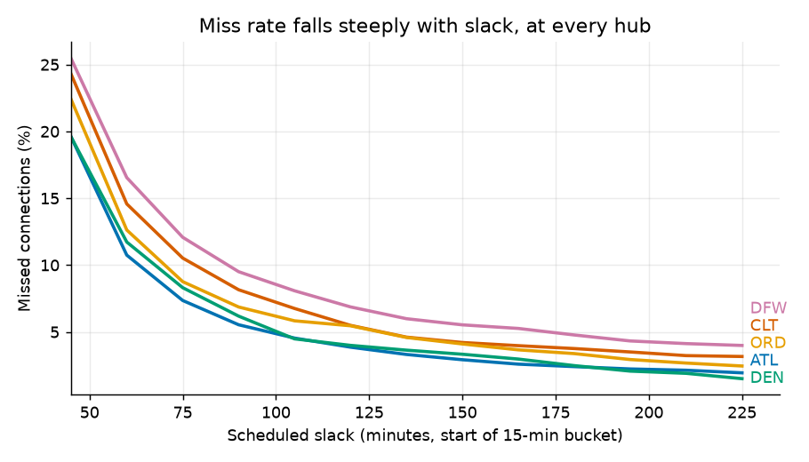
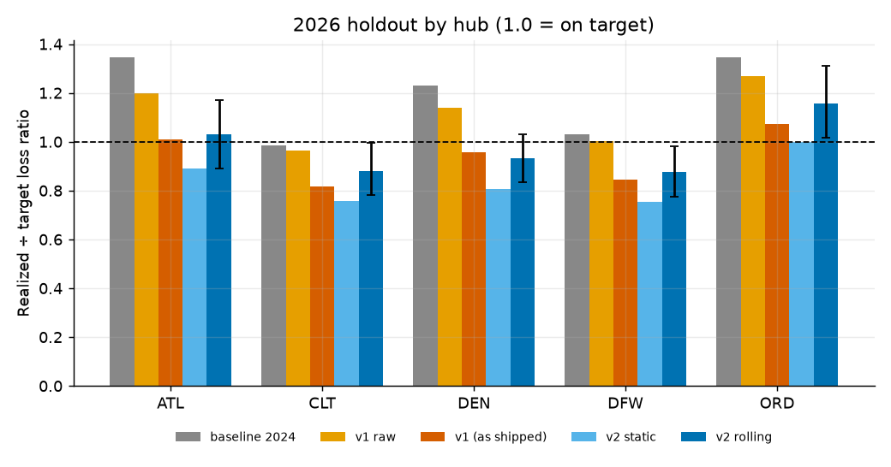
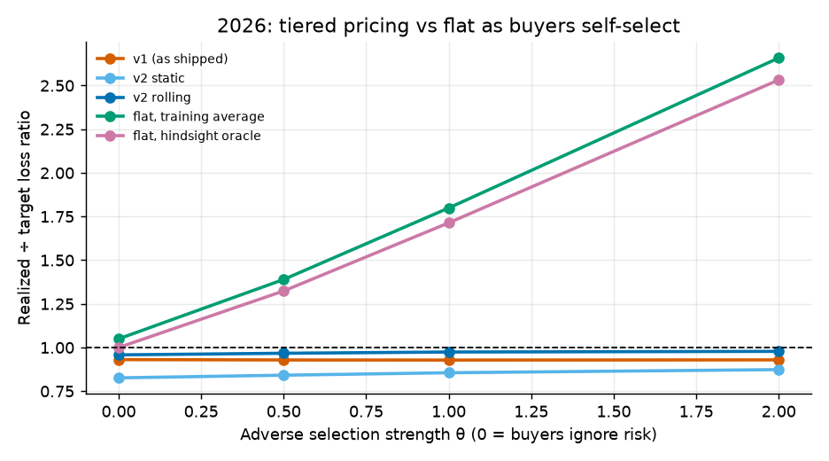

# Missed-connection protection pricing

> **Prices fixed before the test ran a 60.5% loss ratio on 37.1 million connections from January to August 2026 (95% interval 55.4% to 66.1%) against a 65% target. A flat price would have run 117% if buyers favour risky connections. Under a 10% price cap, protection should not be offered below about 60 minutes at DEN, CLT, DFW and ORD (45 at ATL); that cut-off moves to 75 to 105 minutes at a 5% cap, because it comes from an assumed cap, not from the data.**

**[Try the live demo](https://dbechrakis.github.io/missed-connection-pricing/)** · [Product brief](docs/product-brief.md) · [Method](docs/method.md) · [Validation](VALIDATION.md) · [Decision log](docs/decisions.md)

How much should an online travel agency charge to protect a connection, and on which connections should it not offer protection at all? This repository answers with a price table by hub, airline and connection time, and an offer rule, built only from public data, with a validation designed so the answer cannot be flattered.

## The result in three pictures

**1. The risk is real and steep.** About 21% of 45 to 59 minute connections are missed, against about 3% at 210 minutes or more. Price follows risk: about eight times as much for the tightest connections.



**2. Pricing per connection holds up on data it never saw.** Realized ÷ target loss ratio by hub on January to August 2026 (1.0 is on target). The 2024 baseline under-prices; the two final versions land within about 7% of target overall.



**3. Why not one price?** As buyers favour risky connections (θ rises), a flat price drifts to 2.7× the target; the per-connection price barely moves. At θ = 0 (buyers ignore risk) a flat price is about as good, so the case for tiering is robustness to *who buys*, which only an experiment can measure.



| Jan to Aug 2026, θ = 0 | Loss ratio (target 65%) | 95% interval |
| --- | --- | --- |
| 2024 baseline (hub × connection time) | 76.3% | 69.8 to 83.3 |
| **v1, frozen before 2026** | **60.5%** | 55.4 to 66.1 |
| **v2, recalibrated monthly** | **62.3%** | 56.9 to 67.8 |
| v2, calibrator frozen at December 2025 | 53.7% | 49.4 to 58.3 |
| One flat price | 68.2% | 62.6 to 74.3 |

## What this does **not** show

These are limits, not footnotes.

- **The connections are synthetic.** They are every same-airline pairing of an arriving and a departing flight at five US hubs, weighted by real route traffic. The data does not say which passengers actually connected, so risk is modelled, not observed in travellers.
- **The minimum connection time is an assumption** (45 minutes; 35 and 60 tested on the label). Same airline only, US domestic only.
- **Costs, the 65% target and the 10% price cap are assumptions** ($75 to rebook, $180 more if the next flight is the next day). The headline ratio hardly depends on the dollar amounts; the prices and the offer cut-off do.
- **Demand is untested.** On one ticket an airline usually rebooks a missed connection for free, so protection must cover something extra. How many people would buy, at what price, and how strongly the riskiest connections self-select (θ) need an experiment ([designed in the brief](docs/product-brief.md#7-the-experiment)).
- **Severity is a lower bound.** Seat availability on the next flight is not observable.
- **No seasonal price.** A month term learned from two years partly memorises one-off events; the version that helped re-learns the *level* each month instead.
- **Hubs are not equally well priced.** In every version Chicago (ORD) runs about 16% too cheap and Charlotte (CLT) and Dallas (DFW) about 12% too dear.
- **Eight months, 35 weeks of clean test data.** The intervals are wide (about ±0.08 around the ratio).
- **Learning the loss ratio takes about 27 weeks to ±10% at any volume**, because weather and operations hit all travellers in a week at once.

## How it was validated

Prices are set from information up to the booking, then scored on months the model has never seen. Every test was **pre-registered**: the protocol, the frozen model hashes and the list of what may not change afterwards were committed before the window was read, so the git history shows nothing was tuned on it.

| Window | Role | Result |
| --- | --- | --- |
| 2024 to mid-2025 | Fit and select v1 | Brier skill over the baseline about 5% (booking-time information is mostly connection time) |
| July to December 2025 | v1 backtest, read once | 59.1% loss ratio vs 65% (spent; v1 over-priced because its calibrator carried a high level) |
| through December 2025 | v2 development (walk-forward) | Not quoted as validation |
| **January to August 2026** | **Clean holdout of v1 and v2, read once** | **60.5% and 62.3%**, both intervals contain 65% |

What did not go as hoped is written up in [`VALIDATION.md`](VALIDATION.md): v2 did not clearly beat v1 on the headline, a frozen calibrator on a month term priced 17% too high, and one of the four pre-registered expectations was not supported.

## Reproduce

Python 3.12. About 3 GB of downloads and 6 GB of Parquet on disk. On a laptop the compute (DuckDB, scikit-learn) is roughly two hours in total; download time depends on how BTS throttles you. Raw data is not in the repository.

```bash
pip install -r requirements.txt
bash scripts/download_data.sh                       # DB1B and weather (BTS On-Time is fetched by ingest)
cd src
python -m mcp.ingest --start 2024-01 --end 2025-12  # BTS On-Time to Parquet
python -m mcp.ingest --source asos
python -m mcp.ingest --source db1b                  # route weights from the train quarters
python -m mcp.connections --mct 45 35 60            # synthetic connections and the label (MCT 45, with 35 and 60 as sensitivity)
python -m mcp.connections --mct 45 --no-build --weighted   # attach the DB1B route weights
python -m mcp.model                                 # baseline and metrics
python -m mcp.features                              # booking-time feature samples
python -m mcp.model models && python -m mcp.model final   # v1: logistic, boosting, calibration
python -m mcp.pricing                               # severity, price table, sensitivity
python -m mcp.backtest                              # the July to December 2025 backtest (reads the test window once)
python -m mcp.v2 select && python -m mcp.v2 fit     # v2: walk-forward selection on 2025 and the final fit
cd .. && python -m pytest                           # the test suite (no data needed)
```

The 2026 holdout is sealed behind its own steps; read [`VALIDATION.md`](VALIDATION.md) Part 3 before running them:

```bash
cd src
python -m mcp.ingest --start 2026-01 --end 2026-08
python -m mcp.connections --start 2026-01 --end 2026-08 --quiet --weighted   # counts only, never outcome rates
python -m mcp.pricing --full-severity
python -m mcp.holdout                               # reads the 2026 months once
python -m mcp.experiment                            # experiment sizes for the product brief (uses the holdout's weekly variability)
python -m mcp.demo                                  # rebuilds site/prices.js for the demo
```

## Repository

```
src/mcp/        ingest, connections, split, features, model, calibration, v2, pricing, experiment, backtest, holdout, demo
config/         pricing.yaml (assumptions, frozen), guards.yaml (price floor), connections settings
site/           the static demo (index.html + prices.js), published to GitHub Pages
tests/          label logic, leakage, pricing maths, validation accounting, guards on the test windows
notebooks/      01_eda.py (cells run as a script or as a notebook)
docs/           method.md, product-brief.md, decisions.md, figures/
results/        every number quoted above, as JSON/CSV produced by the code
VALIDATION.md   the pre-registered protocols and results, including what went wrong
```

## Data sources

[BTS Airline On-Time Performance](https://transtats.bts.gov/DatabaseInfo.asp?QO_VQ=EFD) · [BTS DB1B Origin and Destination Survey](https://transtats.bts.gov/DatabaseInfo.asp?QO_VQ=EFI) · [Iowa Environmental Mesonet ASOS](https://mesonet.agron.iastate.edu/request/download.phtml). All public. No company data is used anywhere in this project.

Author: [Dimitris Bechrakis](https://github.com/dbechrakis) · [MIT License](LICENSE)
