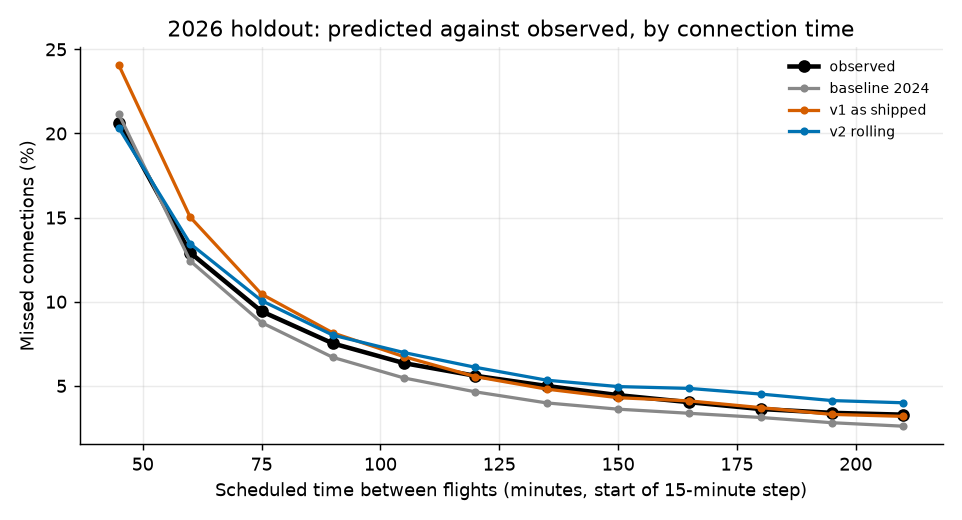
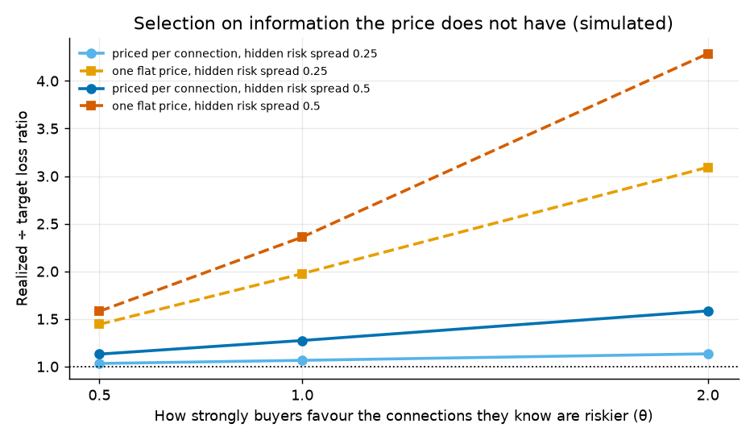
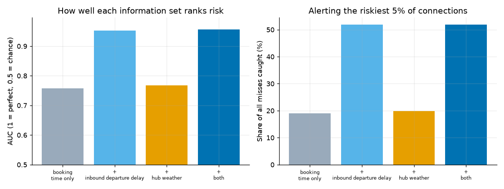

# Missed-connection protection pricing

> **Should a travel agency sell protection against missing a connection, at what price, and where should it refuse?** Answered from public US data only, then tested in public: the predictions below were written, hashed and tagged before the data they are judged on exists.

| If you have | Read |
| --- | --- |
| **30 seconds** | the four lines below, then the [live demo](https://dbechrakis.github.io/missed-connection-pricing/) |
| **5 minutes** | the [one-page decision memo](docs/decision-memo.md) |
| **30 minutes** | the [limits table](#what-this-does-not-show), then [`VALIDATION.md`](VALIDATION.md) Part 5 and the [scoreboard](SCOREBOARD.md) |
| **An agency's view** | [what only the agency can supply](docs/agency-inputs.md), the [experiment plan](docs/experiment-plan.md) and the [demand survey](docs/survey-instrument.md) |

**The decision, in four lines** ([one-page memo](docs/decision-memo.md)):

1. **Price per connection, never one flat price.** Prices fixed before the test ran a **60.5%** loss ratio on 37.1 million unseen connections from January to August 2026 (95% interval 55.4% to 66.1%), against a 65% target. A flat price would have run 117% if buyers favour risky connections.
2. **Refuse to sell where the price is too large a share of the fare.** Under an assumed 10% price cap, fewer than half of the connections under about 60 minutes can be priced within the cap at DEN, CLT, DFW and ORD (Atlanta has no such limit). At a 5% cap that line moves to 75 to 105 minutes. It comes from the assumed cap and costs, not from the data.
3. **Airlines already pay for much of this, so the product worth building covers the gap they leave.** That is the hotel night after a weather or air-traffic disruption. It carries a correlated weather risk the margin must absorb, and is [pre-registered](PREREGISTRATION_2026H2_V3.md) and is judged on September to November 2026.
4. **As it would be sold in 2024 to 2026, the cover lost money in bad months, and a price loading helps but does not fix it (the 2019 to 2023 backcast did not repeat it, see round four).** Over 26 backtest months it ran a 75% loss ratio against a 65% target. A price loading refitted each month on earlier months only cut that to 70% over 19 out-of-sample months (from 78% on the same months); its frozen value, 1.16, is pre-registered as [v4](PREREGISTRATION_2026H2_V4.md) and has no out-of-sample result yet. Weather moves whole months at once, so the rest needs an exposure cap, not a price.

**[Try the live demo](https://dbechrakis.github.io/missed-connection-pricing/)** · [Decision memo](docs/decision-memo.md) · [Product brief](docs/product-brief.md) · [Method](docs/method.md) · [Validation](VALIDATION.md) · [Decision log](docs/decisions.md)

How much should an online travel agency charge to protect a connection, and on which connections should it not offer protection at all? This repository answers with a price table by hub, airline and connection time, and an offer rule, built only from public data, with a validation designed so the answer cannot be flattered.

**What is real and what is modelled.** Real: every flight's scheduled and actual times, cancellations and delay causes (8.1 million flights, BTS); passengers and fares by route (DB1B ticket sample); hotel and meal rates (GSA); which airlines commit to a hotel (DOT); weather. Modelled: which passengers connected (every same-airline pairing, weighted by real route traffic), the minimum connection time, how travellers choose among pairings, and demand. [Details and a test of how much the pairing assumption matters](VALIDATION.md).

## Round two: who already pays, and a cover for the gap (v3)

An audit of the assumptions above changed the product question ([`VALIDATION.md`](VALIDATION.md) Part 5).

- **Airlines already pay for most of what v1 insures.** US airlines commit to a hotel when an overnight disruption is their fault. BTS delay causes say the airline caused 27.5% of missed connections, and late-arriving aircraft caused another 31.9%. So **40.6% to 72.5%** of misses fall in a gap nobody covers, depending on whether late aircraft count as the airline's fault.
- **v3 pays only in that gap:** the official GSA hotel-and-meals rate for the hub and month, when the connection is missed, the next flight is the next day, and BTS does not code the inbound problem to the airline. Every condition can be checked from public data. [Try it in the demo](https://dbechrakis.github.io/missed-connection-pricing/#gap-cover).
- **Costs and the cap are now sourced.** A night costs $198 to $295 by hub and year (GSA), so the $180 assumption was 9 to 39% too low. The cap is 5% of fare, below what comprehensive travel insurance costs (about 4 to 10% of trip cost; [what the market evidence does and does not support](docs/market-evidence.md)).
- **Connections follow how tickets are sold.** A Charlotte passenger on American often flies a PSA or Piedmont regional flight. Pairing by marketing airline doubles the population to 115.8 million connections in 2025.
- **What the data says about the gap cover:** whole months come in 20 to 40% above or below the price, and no model choice removes it: no month term, no recalibration, no training on overnight connections only, and refitting the model eight times on resampled training data moves the pooled result by about 0.01. This is a correlated weather and air-traffic risk, carried by the margin and not by the model. On March to August 2026, outside its training data, v3 ran at **1.12** × target. Offering it only where the price is under 5% of fare reaches 39% of overnight-risk connections, which run 9% worse (the winner's curse of selecting on a low estimate). **Sold that way, the cover would have lost money in the worst months:** over 26 backtest months, a 75% realized loss ratio against the 65% target, 6 of 26 months above 100%, 28 of 114 weeks above 100%, worst week 248%, before any commission or handling cost.
- **Pre-registered** before September to December 2026 existed and judged on September to November, with six falsifiable expectations and everything seen beforehand disclosed: [`PREREGISTRATION_2026H2_V3.md`](PREREGISTRATION_2026H2_V3.md). A weekly workflow opens an issue as each month is published.

## Round three: self-transfers, pre-registered and failed on the headline (v5)

The brief named separate tickets as the case where protection matters most, because no airline owes anything across two tickets. [`PREREGISTRATION_V5_SELF_TRANSFER.md`](PREREGISTRATION_V5_SELF_TRANSFER.md) fixed the design before any cross-airline pairing was built: pairings of two different marketing networks at the five hubs, 90 to 300 minute gaps, a miss on any cause with a 90-minute self-transfer minimum, a payout of the DB1B nonstop onward fare plus a GSA night when no later flight exists, and a cell table. January to August 2026 was read once.

- **The price is not right on average.** The table paid out **1.16** times its expected cost on 3.2 million 2026 pairings [1.05, 1.28], a 75% loss ratio against 65%. The pre-registered band was 0.85 to 1.15, so **S1 failed** and the cover is not priced as it stands. The level rose from 2024 to 2026, as for v3.
- **The other four held:** a quarter of misses follow a cancellation or diversion, risk falls steeply with the gap (about 25% at 90 minutes against 5% to 8% at 165), months vary with a standard deviation of 0.17, and the cap selects slightly worse risk.
- **What it would cost:** a median $85 at 90 to 104 minutes (19% of the two-ticket fare) and $19 over all gaps, against a $226 median payout.
- **The repair is pre-registered, and the development data already says it is not enough.** [`PREREGISTRATION_V5_1_LEVEL.md`](PREREGISTRATION_V5_1_LEVEL.md) refits the table on every month published when a cover is sold and chose, by a rule fixed in advance, among five level corrections. It chose none, because none helped: on 14 development months every candidate still paid out 1.12 to 1.16 times its price, since a level learned five months late trails a level that keeps rising. Its prices for September to November 2026 are frozen and are read once when November is published. The next repair, a loading of 1.16 on the price as v4 used for the gap cover, is pre-registered in [`PREREGISTRATION_V5_2_LOADING.md`](PREREGISTRATION_V5_2_LOADING.md) and frozen for December 2026 to February 2027, the storm season. On development months a loading re-estimated from earlier months brought 1.154 to 1.005 out of sample.
- **The definition of a miss matters as much as the model:** with a 120-minute minimum the same procedure lands at 1.05, with 60 at 1.23. [`VALIDATION.md`](VALIDATION.md) Part 6 has every number.

**For the read in February 2027.** Besides the four tests the scheduled job runs, v5.1 needs two commands once September to November are published:

```bash
cd src && python -m mcp.v5 build --t 90 --sealed --start 2026-09 --end 2026-11    # counts only
python -m mcp.v5_1 holdout && python -m mcp.grade                                 # the single read, then the scoreboard
```

And for v5.2, once February 2027 is published (probably early May 2027):

```bash
cd src && python -m mcp.v5 build --t 90 --sealed --start 2026-12 --end 2027-02    # counts only
python -m mcp.v5_2 holdout && python -m mcp.grade
```

## Round four: eight years of weeks, a calendar pattern and what it changes (season 2, 12 November 2026)

Season 1 answered "is the price right on average?" on 32 months. Season 2 took six earlier years the project had never loaded (2018 to 2023, same public files), pre-registered every test before the data was on disk, and read each once. The full record is [`VALIDATION.md`](VALIDATION.md) Part 7 and the plan is [`docs/season2-plan.md`](docs/season2-plan.md).

- **The pricing procedure travelled.** Priced from earlier months only, it ran **0.96** of expected claims over 44 non-pandemic months of 2019 to 2023 (band 0.83 to 1.17), and the monthly spread was 0.245, as 26 months had said (0.241). Three of the eight backcast expectations passed and five failed, and the failures are the useful part (7B).
- **"The cover as sold loses money" did not repeat.** Within the 5% cap the backcast ran **60.6%** against a 65% target over the 44 months (55.7% over the 37 that have a loading), and 1 month of 44 was above 100%. 2024 to 2026 ran a 75% loss ratio. Arm A of the backcast (all earlier months) did far better as sold than arm B (the last 24 months). An exploratory arm with the same long history and the pandemic months left out of the fit did as badly as arm B (68% as sold), so arm A's advantage came from something in the pandemic-year fit and not from the length of its history (`VALIDATION.md` 7I). The usual outcome as sold is a loss ratio above target with bad weeks, and 60.6% is the exception.
- **Following a moving level does not pay.** A local-level model and the last 12 months both did worse than a constant level on months they had not seen, in development (7A) and in the backcast (7B). A loading did not reach its line in 2019 to 2023 (2.9 points against 3.0) and **hurt** the self-transfer cover (0.912 against 0.981), whose 2026 failure came from a level that kept rising.
- **There is a calendar pattern.** The month-of-year multipliers on expected claims run from 1.27 in June and July to 0.72 in November, and the five summers in the record all ran 19% to 42% above their expected claims. Predicting a year from the others cuts the monthly error from 0.206 to 0.125 (7G, exploratory). Frozen multipliers are pre-registered for March to August 2027 and for a prediction about September to November 2026, which the scheduled job will read.
- **What the margin has to carry.** On 306 weeks, the existing price needs about 1.00 to 1.03 times itself at a 35% expense share, and the annual capital term is 0.3% to 2.5% of premium. The weeks are the problem: 17% of weeks as sold ran above 100%, and a weekly stop-loss costs 5.1% of premium (7C). The five hubs share part of their weather (a five-hub weekly ratio varies 0.67 times as much as one hub).
- **A same-night trigger is narrower and cleaner.** FAA ground stops and weather pay a quarter to two fifths of what the BTS-coded gap pays and rarely pay the airline's own delays (11% to 14%) (7D). Whether airlines moved their delay coding after the hotel commitments is **not settled**: the placebo failed its pre-registered band (7E).
- **A forecast helps a little, near the day.** As issued 1 to 3 days ahead it improves the log loss by about 1% to 1.6% and nothing at a week. A rule that stops selling where the forecast says the risk is 1.5 times the price recovers the loss ratio from about 80% to 72% when late buyers select on the forecast, and barely moves the count of bad weeks (7F).

## What this does **not** show

These are limits, not footnotes. Of the 14 limits this project started with, **5 are closed**, **8 are reduced** to one named input only an agency can supply or to a test that is under way, and **1 is open** because it needs customers. Each row says what was found and what closes the rest; the inputs are collected in [`docs/agency-inputs.md`](docs/agency-inputs.md) and the work is in [`VALIDATION.md`](VALIDATION.md) Part 5.

| # | Limit | Status | What was found | What closes the rest |
| --- | --- | --- | --- | --- |
| 1 | The connections are synthetic | **Reduced** | 97.7% of real hub-connecting passengers (DB1B ticket sample) are on a route we model. Pairings without a ticket-sample route miss at 9.15% against 9.23%: no bias. Across five stylised ways travellers might choose connections the sold loss ratio stays between 72.5% and 74.6%; only reach moves (9% to 67%) | Which passengers actually connected: the agency's itineraries |
| 2 | The minimum connection time is assumed (45 minutes) | **Reduced** | Prices set for 45 pay out 0.90× the expected amount at a true 35 and 1.57× at 60. The model now takes the minimum as an input, unretrained: 1.11×, 1.12×, 1.13× at 35, 45, 60 (demo selector) | Each airline's real minimum, and whether it is the right definition of a miss: the agency |
| 3 | Costs, the 65% target and the price cap are assumptions | **Reduced** | Hotel and meals from GSA ($198 to $295 a night). Cap 5%, below the 4 to 10% of trip cost that travel insurance charges. Grid of 3 to 10% × 55 to 75%: 15% to 67% of overnight-risk connections offered. As sold the loss ratio is 75% | The agency's expense ratio and target |
| 4 | Demand is untested | **Open** | Not closable from data. The experiment's analysis and decision rule ([`docs/experiment-plan.md`](docs/experiment-plan.md)) and a stated-demand survey ([instrument](docs/survey-instrument.md), [pre-registered](PREREGISTRATION_SURVEY.md), [fielding steps](docs/survey-fielding.md)) are written and checked on simulated answers; the survey can rule the idea out cheaply, not prove it. At $10.01 a policy and a 75% loss ratio, margin is $2.52 a policy before expenses and $0.52 at 20% | The pricing experiment |
| 5 | Severity is a lower bound | **Closed** | v3 pays the government per-diem rate when the next flight is the next day: the benefit is defined by the schedule, so seat availability does not enter | — |
| 6 | No seasonal price | **Closed** | Tested: a month term, recalibration and overnight-only training do not remove the swings. Over 26 backtest months the monthly ratio has a standard deviation of 0.24: weather. The payout does move by month (GSA) | — |
| 7 | Hubs are not equally well priced | **Reduced** | Chicago ran 0.92 in 2024, 1.18 in 2025 and 1.23 in 2026: a drift, not a standing gap. Its long-connection misses are 50% weather and air-traffic coded | The pre-registered per-hub arm of the v3 test |
| 8 | Monthly recalibration assumes the whole previous month is known | **Closed** | v3 uses no recalibration, and its selection was walk-forward with a one-month booking lag | — |
| 9 | Eight months of clean test data | **Reduced** | Extended for development to 26 months by a rolling-origin backtest, then by a **backcast on 44 months of 2019 to 2023** that was pre-registered before those years were loaded and read once ([`VALIDATION.md`](VALIDATION.md) 7B): three of eight expectations passed, five failed. The clean test of September to November 2026 is read once, when November is published (probably early February 2027), and the seasonal price is tested forward on March to August 2027. For v1 and v2 only, one final read with December follows when it is published (`VALIDATION.md` 5M) | Time, for the forward tests |
| 10 | Learning the loss ratio takes at least 27 weeks | **Reduced** | For v3 it is longer: about 202 weeks to ±10% as sold (94 for all overnight-risk connections), because weather hits a whole week at once | Nothing: it is how the risk behaves. The margin has to be set from the model and reinsurance, not learned from claims |
| 11 | The intervals are probably a little narrow | **Closed** | Month-block bootstrap over 26 months: the mean monthly ratio is 0.91 to 1.17 for all overnight-risk connections and 0.94 to 1.31 as sold | — |
| 12 | Not every synthetic connection is a real itinerary | **Reduced** | 79% of pairings sit on a ticket-sample route and the rest behave the same; the regional-brand mismatch is gone because v3 pairs within the marketing network | Same as the first row |
| 13 | An onward flight cancelled by the airline is not covered | **Reduced** | Onward flights cancelled for weather, air traffic or security would add 20.7% to the events the cover pays (Dallas 32%, Denver 9%). Airline-coded ones are the airline's to pay | A product decision: sell the trigger or not |
| 14 | The loss ratio realizes the miss event, not what a miss cost | **Closed** | In v3 the cost of a claim is the benefit the cover is defined to pay, not an estimate of someone's loss | — |

**Found while closing these, and not closed:** sold only where the price fits the 5% cap, the cover would have shown a 75% realized loss ratio against the 65% target, 6 of 26 months above 100%, 28 of 114 weeks above 100%, worst week 248%, before any commission or handling cost. The cap selects connections the model under-prices. A loading on the price, refitted each month on earlier months only (1.00 to 1.23, 1.13 on average), moved the sold loss ratio from 77.8% to 70.4% over 19 out-of-sample months. The pre-registered v4 freezes it at 1.16, fitted on all 26 months, so 1.16 itself is first judged on September to November 2026. That is not enough to reach 65%, and it does not remove bad weeks ([`VALIDATION.md`](VALIDATION.md) 5L, [`PREREGISTRATION_2026H2_V4.md`](PREREGISTRATION_2026H2_V4.md)).

**Also not covered, and outside the 14 limits** (added 9 November 2026 after an external review):

- **Claims cannot be paid on the night.** The trigger needs the BTS cause code of the inbound delay, and BTS publishes a month's file about two months after the month ends (November 2026 is expected in early February 2027). A traveller stranded tonight would wait one to three months to be paid, or the agency pays first and recovers later on a provisional rule. Either changes what is being sold, and neither is priced here.
- **Airlines code their own delay causes.** The cover pays exactly when the cause is *not* coded to the airline, and the DOT hotel commitments make an airline-coded overnight delay costly for the airline. If carriers shift coding toward weather or air traffic control, payouts rise with no change in the weather. Expectation V5 (70% to 90% of overnight misses in the gap) is the early warning. A launched cover would need its own check of coding against a second source.
- **The served share within the cap is at the unloaded price.** `/gap-quote` returns the v3 price and the loaded (v4) price, but the share of connections that fit the 5% cap is stored per cell at the v3 price only. At the loaded price fewer fit, by an amount the table cannot give for one cell (36% instead of 41% overall in the backtest, `VALIDATION.md` 5L).

## How it was validated

**[Scoreboard](SCOREBOARD.md):** every pre-registered prediction (57 across twelve documents), each graded by a rule written before the data exists, and its status. Sixteen have been read: the five self-transfer predictions (one failed), the two forecast predictions (both passed), the coding audit's placebo (failed), and eight of the backcast's ten (three passed, five failed). The other 41 are pending.

Prices are set from information up to the booking, then scored on months the model has never seen. Every test was **pre-registered**: the protocol, the frozen model hashes and the list of what may not change afterwards were committed *locally* before the window was read. They reached GitHub together with the results, so the commit times are the author's own and cannot be independently checked; the two model files are in the repository so the frozen hashes can be verified. The next test (BTS data for September to December 2026, not yet published) has its protocol, frozen hashes and falsifiable expectations in [`PREREGISTRATION_2026H2.md`](PREREGISTRATION_2026H2.md), written and tagged before the data exists.

| Window | Role | Result |
| --- | --- | --- |
| 2024 to mid-2025 | Fit and select v1 | Brier about 1 to 2% better than a hub × connection-time baseline (itself about 5% better than a flat rate): booking-time information is mostly connection time |
| July to December 2025 | v1 backtest, read once | 59.1% loss ratio vs 65% (spent; v1 over-priced because its calibrator carried a high level) |
| through December 2025 | v2 development (walk-forward) | Not quoted as validation |
| **January to August 2026** | **Clean holdout of v1 and v2, read once** | **60.5% and 62.3%**, both intervals contain 65% |

What did not go as hoped is written up in [`VALIDATION.md`](VALIDATION.md): v2 did not clearly beat v1 on the headline, a frozen calibrator on a month term priced 17% too high, and one of the four pre-registered expectations was not supported.

## Evidence and reproduction

<details>
<summary><b>The v1 evidence in pictures, and the 2026 holdout table</b></summary>

**1. The risk is real and steep.** About 21% of 45 to 59 minute connections are missed, against about 3% at 210 minutes or more. Price follows risk: about eight times as much for the tightest connections.


**2. Pricing per connection holds up on data it never saw.** Realized ÷ target loss ratio by hub on January to August 2026 (1.0 is on target). The 2024 baseline under-prices; the two final versions land within about 7% of target overall.


By connection time, v1 as shipped follows what happened most closely (its predictions are on average 6% from the observed rate), while v2 with monthly recalibration gets the overall level right but is about 12% off by connection time, too high for long connections ([`notebooks/02_model.py`](notebooks/02_model.py)):



**3. Why not one price?** If buyers lean toward the connections the model already rates as risky (θ rises), a flat price drifts to 2.7× the target while the per-connection price barely moves. At θ = 0 (buyers ignore risk) a flat price is about as good. This test is deliberately generous to tiering: a calibrated model cannot lose to selection on its own probability. The harder case, buyers who know something the model does not, is simulated in the fourth picture.


**4. What if buyers know more than the model?** Give every connection a hidden risk factor that buyers can see and the price cannot (spread κ, on a log scale), and let buyers favour risky connections with strength θ. Pricing per connection then runs at **exp(θκ²) × target** whatever the data (simulated on our real risk distribution to confirm), while a flat price suffers that *and* the selection on visible risk. At θ = 1: κ = 0.25 gives 1.06 (per connection) against 1.98 (flat); κ = 0.5 gives 1.27 against 2.36. κ cannot be measured from public data; the model's own errors by month and by hub put a floor of about 0.12 to 0.14 on it (about 2% exposure at θ = 1). So per-connection pricing is never worse than a flat price, but it is not immune; how exposed it is depends on something only an experiment can measure ([`mcp.selection`](src/mcp/selection.py), exploratory).



| Jan to Aug 2026, θ = 0 | Loss ratio (target 65%) | 95% interval |
| --- | --- | --- |
| 2024 baseline (hub × connection time) | 76.3% | 69.8 to 83.3 |
| **v1, frozen before 2026** | **60.5%** | 55.4 to 66.1 |
| **v2, recalibrated monthly** | **62.3%** | 56.9 to 67.8 |
| v2, calibrator frozen at December 2025 | 53.7% | 49.4 to 58.3 |
| One flat price | 68.2% | 62.6 to 74.3 |

</details>

<details>
<summary><b>Reproduce it (data, commands, the sealed holdout, v3 and the audit)</b></summary>

Python 3.12. About 3 GB of downloads and 6 GB of Parquet on disk. On a laptop the compute (DuckDB, scikit-learn) is roughly two hours in total; download time depends on how BTS throttles you. Raw data is not in the repository.

```bash
pip install -r requirements.lock                    # the exact versions the frozen models were built with (requirements.txt gives looser ranges)
bash scripts/download_data.sh                       # DB1B and weather (BTS On-Time is fetched by ingest)
cd src
python -m mcp.ingest --start 2024-01 --end 2025-12  # BTS On-Time to Parquet
python -m mcp.ingest --source asos
python -m mcp.ingest --source db1b                  # route weights from the train quarters
python -m mcp.connections --mct 45 35 60            # synthetic connections and the label (MCT 45, with 35 and 60 as sensitivity)
python -m mcp.connections --mct 45 --no-build --weighted   # attach the DB1B route weights
python -m mcp.model                                 # baseline and metrics
python -m mcp.features                              # booking-time feature samples
python ../notebooks/01_eda.py                       # exploratory figures (docs/figures) and results/eda.json; train and validation months only
python -m mcp.model models && python -m mcp.model final   # v1: logistic, boosting, calibration
python -m mcp.pricing                               # severity, price table, sensitivity
python -m mcp.selection                             # exploratory: adverse selection on information the price lacks
python -m mcp.voi                                   # exploratory: what day-of information would add (development data)
python -m mcp.backtest                              # the July to December 2025 backtest (reads the test window once)
python -m mcp.v2 select && python -m mcp.v2 fit     # v2: walk-forward selection on 2025 and the final fit
cd .. && python -m pytest                           # the test suite (no data needed)
```

The 2026 holdout is sealed behind its own steps; read [`VALIDATION.md`](VALIDATION.md) Part 3 before running them:

```bash
cd src
python -m mcp.ingest --start 2026-01 --end 2026-08
python -m mcp.connections --start 2026-01 --end 2026-08 --quiet --weighted   # counts only, never outcome rates
python -m mcp.pricing --full-severity
python -m mcp.holdout                               # reads the 2026 months once
python -m mcp.experiment                            # experiment sizes for the product brief (uses the holdout's weekly variability)
python -m mcp.demo                                  # rebuilds site/prices.js for the demo
```

v3 has its own files, switched by one environment variable (v1 and v2 files are never touched):

```bash
cd src
export MCP_VARIANT=v3
python -m mcp.ingest --start 2024-01 --end 2026-08 && python -m mcp.ingest --source db1b   # BTS Marketing Carrier file; DB1B by ticketing carrier
python -m mcp.connections --mct 45 35 60 && python -m mcp.connections --mct 45 --no-build --weighted
python -m mcp.pricing --full-severity
python -m mcp.causes                                # who caused each missed connection (BTS delay causes)
python -m mcp.costs                                 # GSA hotel + meals by hub and month (cached pages in data/external/gsa)
python -m mcp.v3 select && python -m mcp.v3 fit     # walk-forward selection with a booking lag, final fit
python -m mcp.holdout_v3 9 10 11                    # ONLY under PREREGISTRATION_2026H2_V3.md, after the data is published
```

The audit of the 14 limits (development months only; none of it reads the pre-registered window):

```bash
cd src
export MCP_VARIANT=v3
python -m mcp.v3_audit frames && python -m mcp.v3_audit bootstrap && python -m mcp.v3_audit report   # refit bootstrap, cap x loss ratio grid, exposure, minimum connection time
python -m mcp.v3_rolling run && python -m mcp.v3_rolling report                                      # 26 out-of-sample months (about an hour)
python -m mcp.commitments                           # which airlines pay for the hotel (data/external/dot)
python -m mcp.outbound                              # onward flights cancelled for reasons that are not the airline's
python -m mcp.coverage                              # how much real hub traffic the connections represent
python -m mcp.economics                             # what attach rate the cover needs
```

</details>

<details>
<summary><b>What the day itself would add (value of information)</b></summary>

The price is quoted at booking, so it can only use what is known then. The spec's open question: how much would day-of information improve things, and does it justify a second product, an alert to the traveller? With the alert placed one hour before the inbound flight's scheduled arrival, knowing how late that flight left cuts the booking-time model's Brier error by **44%** and lets an alert on the riskiest 5% of connections catch **52%** of misses at **75%** precision (booking-time information: 19% at 28%). Hub weather adds under 1%, most likely because a delayed flight already carries it. A first version of this analysis leaked each flight's final delay and overstated the value (52% instead of 44%); it is corrected and both are reported in [`VALIDATION.md`](VALIDATION.md) 4H. It does **not** show that an alert would help anyone: that depends on whether a traveller can act in that hour and on what a real-time feed costs.



</details>

## Use it

The same price tables serve the demo page, a command-line tool and a small API, so they cannot disagree. Two products are served: the gap cover the memo recommends (`site/prices_v3.js`), and the original all-purpose cover (`site/prices.js`).

```bash
cd src
python -m mcp.score --gap --hub ORD --minutes 90 --month 2026-12 --mct 60       # the gap cover, at an airline's own minimum
python -m mcp.score --hub ORD --airline UA --minutes 60 --next-flight next      # the original cover
uvicorn mcp.api:app                                                              # API; interactive docs at http://127.0.0.1:8000/docs
python -m mcp.monitor --month 2026-08                                            # monthly recalibration and drift report
```

`/gap-quote` (hub, minutes, month, the airline's minimum connection time) returns the chance of an overnight miss not coded to the airline, the GSA payout, the price, the price with the pre-registered 1.16 loading, the share within the 5% cap, the decision and the caveats. `tests/test_service_gap.py` drives the demo page's own script through every hub, month, minimum and connection time and checks the API shows the same. `/quote` (the original cover) returns the chance of a miss, expected claim cost, price, the share of such connections that fit the price cap, a three-state decision (offer, offer selectively, do not offer), the model's validated loss ratio, the assumptions and the caveats. `/model` reports the SHA-256 of the frozen model files, which match the hashes in [`VALIDATION.md`](VALIDATION.md). The monthly job prices the month with a calibrator built only from earlier months, reports drift by hub and week, alerts when the claim-weighted ratio over the last three months leaves a band sized from the 2025 spread (a rule that replaced hand-picked single-month bands that fired in 5 of 8 months; it is slow on purpose and cannot see steady hub gaps of 12 to 16%, see [`VALIDATION.md`](VALIDATION.md) 4J), and only then adds the month to its state.

## Repository

```
src/mcp/        ingest, connections, split, features, model, calibration, v2, pricing, experiment, backtest, holdout, selection, voi,
                monitor, service, score, api, demo; v3: variant, causes, costs, v3, holdout_v3, v3_audit, v3_rolling, commitments, outbound, coverage, economics
config/         pricing.yaml (assumptions, frozen), guards.yaml (price floor), connections settings
site/           the static demo (index.html + prices.js), published to GitHub Pages
tests/          label logic, leakage, pricing maths, validation accounting, guards on the test windows
notebooks/      01_eda.py, 02_model.py, 03_pricing.py (cells run as scripts or as notebooks; 02 and 03 read only the published results)
docs/           method.md, product-brief.md, decisions.md, figures/
results/        every number quoted above, as JSON/CSV produced by the code
VALIDATION.md   the pre-registered protocols and results, including what went wrong
```

## Data sources

[BTS Airline On-Time Performance](https://transtats.bts.gov/DatabaseInfo.asp?QO_VQ=EFD) · [BTS DB1B Origin and Destination Survey](https://transtats.bts.gov/DatabaseInfo.asp?QO_VQ=EFI) · [Iowa Environmental Mesonet ASOS](https://mesonet.agron.iastate.edu/request/download.phtml). All public. No company data is used anywhere in this project.

Author: [Dimitris Bechrakis](https://github.com/dbechrakis) · [MIT License](LICENSE)
